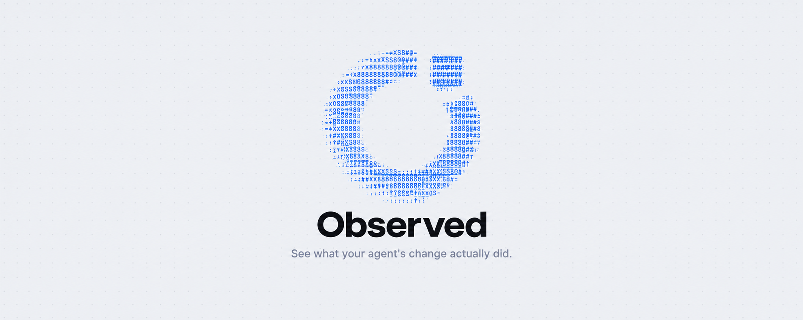

<p align="center"></p>

# Observed

Run any coding agent and see what its change actually did to your app, with evidence a model can't fake.

Observed is being rebuilt. The previous version is on the [`legacy`](https://github.com/esau-morais/observed/tree/legacy) branch and on npm as `@observed-software/cli@0.2.0-alpha.10`.

## How it will work

- Your agent (Claude Code, Codex, opencode or Muse) writes the change.
- Observed runs your app on both revisions and records screenshots, requests and errors.
- Checks written before the change decide what holds. No model gets a vote.

## Work on it

```sh
bun install
bun run check
```

[AGENTS.md](./AGENTS.md) has the layout and the rules.

MIT licensed.
